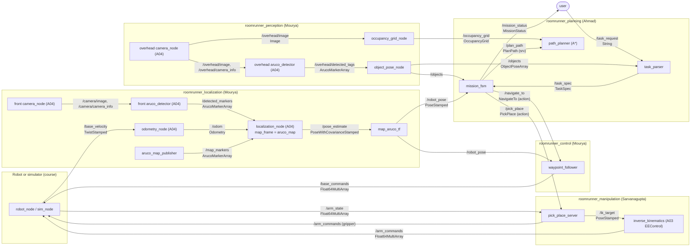
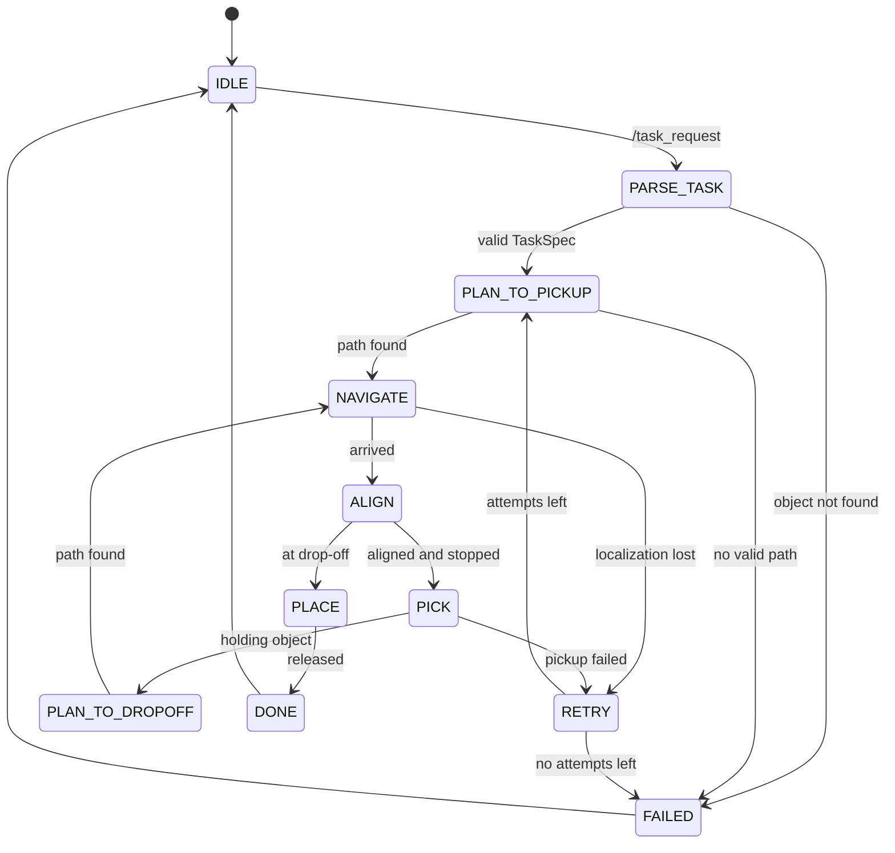
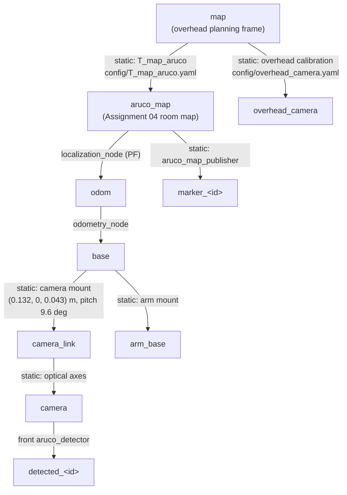

# RoomRunner architecture

Every node, topic, message type and frame of the project. The overhead nodes run on Mourya's laptop (decisions.md); `occupancy_grid_node` and `object_pose_node` in the diagram are
both implemented by `overhead_node`. Nodes marked *(A03)* or *(A04)* are our
assignment nodes, launched unchanged; *(course)* nodes come from the course repository. Units are metres
and radians unless a topic says otherwise. Frames are described in [frames.md](frames.md).

## Data flow

## Topics

| Topic | Type | Frame / units | From | To |
| --- | --- | --- | --- | --- |
| `/task_request` | `std_msgs/String` | free text | user, experiment scripts | `task_parser` |
| `/task_spec` | `roomrunner_interfaces/TaskSpec` | object and place names | `task_parser` | `mission_fsm` |
| `/mission_status` | `roomrunner_interfaces/MissionStatus` | | `mission_fsm` | user, loggers |
| `/planned_path` | `nav_msgs/Path` | `map` | `mission_fsm` | RViz, loggers |
| `/overhead/image`, `/overhead/camera_info` | `sensor_msgs/Image`, `CameraInfo` | `overhead_camera` | overhead `camera_node` | perception |
| `/overhead/detected_tags` | `aruco_interfaces/ArucoMarkerArray` | `overhead_camera` | overhead `aruco_detector` | `object_pose_node` |
| `/occupancy_grid` | `nav_msgs/OccupancyGrid` | `map`, 0 free, 100 occupied, -1 unknown | `overhead_node` (laptop) | `path_planner` |
| `/objects` | `roomrunner_interfaces/ObjectPoseArray` | `map` | `overhead_node` (laptop) | `task_parser`, `mission_fsm` |
| `/overhead_robot` | `geometry_msgs/PoseStamped` | `map` | `overhead_node` (robot-top tag 40) | E1 logger, `T_map_aruco` check |
| `/camera/image`, `/camera/camera_info` | `sensor_msgs/Image`, `CameraInfo` | `camera` | front `camera_node` / `sim_node` | front `aruco_detector` |
| `/detected_markers` | `aruco_interfaces/ArucoMarkerArray` | `camera` | front `aruco_detector` | `localization_node` |
| `/map_markers` | `aruco_interfaces/ArucoMarkerArray` | `aruco_map` | `aruco_map_publisher` | `localization_node` |
| `/base_velocity` | `geometry_msgs/TwistStamped` | `base`, m/s and rad/s | `robot_node` / `sim_node` | `odometry_node` |
| `/odom` | `nav_msgs/Odometry` | `odom` | `odometry_node` | `localization_node` |
| `/pose_estimate` | `geometry_msgs/PoseWithCovarianceStamped` | `aruco_map` | `localization_node` | `map_aruco_tf` |
| `/robot_pose` | `geometry_msgs/PoseStamped` | `map` | `map_aruco_tf` (`fake_robot` in stub mode) | `mission_fsm`, `waypoint_follower` |
| `/base_commands` | `std_msgs/Float64MultiArray` | [forward m/s, left m/s, turn **deg/s**] | `waypoint_follower` | `robot_node` / `sim_node` |
| `/ik_target` | `geometry_msgs/PoseStamped` | `base` | `pick_place_server` | `inverse_kinematics` (A03) |
| `/arm_commands`, `/arm_state` | `std_msgs/Float64MultiArray` | 5 joints in **degrees**, gripper % | IK node, `pick_place_server` / robot | robot / `pick_place_server` |

## Services and actions

| Name | Type | Server | Client | Meaning |
| --- | --- | --- | --- | --- |
| `/plan_path` | `roomrunner_interfaces/PlanPath` (srv) | `path_planner` | `mission_fsm`, task validator | A* path in `map` from start to goal |
| `/navigate_to` | `roomrunner_interfaces/NavigateTo` (action) | `waypoint_follower` | `mission_fsm` | follow a path; succeed when aligned and stopped |
| `/pick_place` | `roomrunner_interfaces/PickPlace` (action) | `pick_place_server` | `mission_fsm` | pick an object or place it |
| `/refresh_map` | `std_srvs/Trigger` (srv) | `overhead_node` (laptop) | `mission_fsm` | take an overhead frame now (before planning, after pick/place) |

## Mission state machine

A request with several steps (E2: 1 to 4 steps) repeats the plan / navigate / align and pick or place
states once per step.

## TF tree

In stub mode there is no particle filter: `fake_robot` publishes `map → base` directly.
